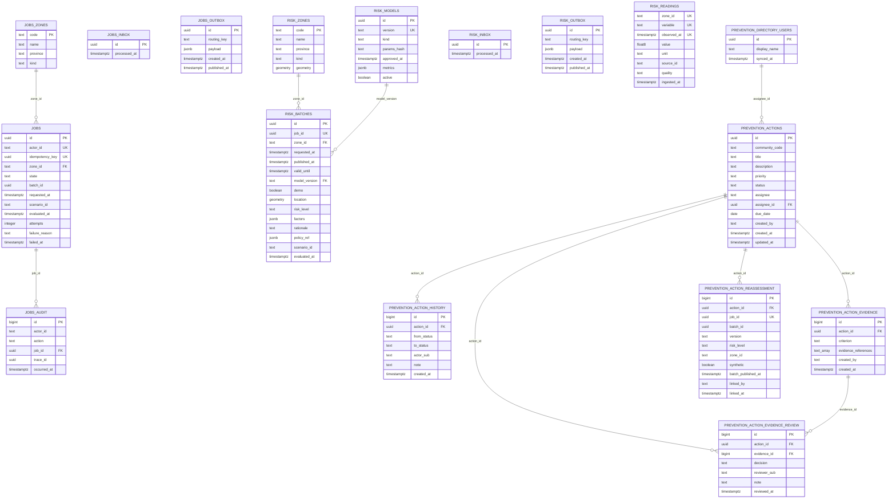

# FireWatch domain data model

This document is the domain model of the FireWatch services over the catalog the
migrations actually produce: what each service-owned relation represents, how a
row is identified, how rows are related, and one ERD that covers all of them. It
is not a physical inventory — tables, types, defaults and constraints are listed
in [`schema-inventory.md`](schema-inventory.md) — and it is not a proposal:
nothing here is to be built, and every entity, column and foreign key below was
read from a migrated database, not from the migration tree. The basis is the
isolated compose project `fw-schema-inv` (`postgis/postgis:17-3.5`: PostgreSQL
17.5 with PostGIS 3.5.2), migrated from zero from HEAD `54d7ea1` plus the
prevention assignment migration, where the catalog holds 22 relations and 138
columns. Seventeen of those relations and 117 of those columns are the service
domain, and those seventeen are this document's complete entity list. The other
five are out of domain scope and are not modelled: the two
`schema_migrations` bookkeeping ledgers (`jobs` and `risk`) and the three PostGIS
extension relations (`geography_columns`, `geometry_columns`,
`spatial_ref_sys`), which no service migration creates and no service reads as
domain data. Where this document and the inventory disagree, the inventory wins;
composing the model found no such disagreement.

Every meaning below is derived from the migrations and from the service code that
writes and reads the relation, never from a table name alone. Relations are named
by database and schema (`jobs.public.*`, `risk.public.*`), and by schema alone
inside the prevention schema (`prevention.*`), which is unambiguous; `prevention`
is a schema of the `risk` database, not a separate database.

## Entities

One subsection per relation, none omitted. A relation appears exactly once: the
two `inbox`, two `outbox` and two `zones` tables are separate relations in separate
databases and are described separately.

### `jobs.public.jobs` — 12 columns

The job: one admin request to assess one zone, plus that request's eventual
outcome. It is the unit the jobs API creates and serves.

- **Identity.** `id` (`jobs_pkey`); the request is additionally unique on
  `(actor_id, idempotency_key)`, which is how a retried POST returns the stored
  row instead of creating a second job.
- **Lifecycle.** Created `queued` when an admin submits a request, it becomes
  `published` with `batch_id` when the completion naming it commits, or `failed`
  with `failure_reason`, `failed_at` and the spent `attempts` when delivery is
  abandoned; an explicit operator replay returns a `failed` row (or a confirmed
  `queued` one) to `queued` with a fresh attempt budget but the original
  `requested_at`.
- **Notes.** `scenario_id` and `evaluated_at` are optional synthetic-demonstration
  metadata, stored and nulled as a pair; `actor_id` is a token subject and no user
  table exists. `batch_id` points into the other database by value only (see
  "Unconstrained references").

### `jobs.public.audit` — 6 columns

The administrative audit trail of the jobs service: one row per audited command or
outcome, answering who did what to which job and under which trace.

- **Identity.** `id`, a `bigint` identity column, so the sequence is the
  chronology.
- **Lifecycle.** Appended inside the same transaction as the effect it records
  (`job.requested` on create and on replay, `batch.published` on completion) and
  never updated or deleted — the application role holds `SELECT` and `INSERT`,
  never `UPDATE` or `DELETE`.
- **Notes.** `action` is not constrained in the schema; the write path and the
  HTTP contract fix its two values, `job.requested` and `batch.published`.

### `jobs.public.outbox` — 5 columns

The jobs service's transactional outbox: the durable record of an event that was
committed together with its business effect and still has to be published.

- **Identity.** `id`, which is the event id carried in `payload`, so a row and its
  message are the same occurrence.
- **Lifecycle.** Inserted in the business transaction with `published_at` NULL;
  the relay claims the oldest pending row under `FOR UPDATE SKIP LOCKED`, publishes
  it with confirms, then stamps `published_at`.
- **Notes.** `routing_key` is the event type (`jobs.requested.v1`); `payload` is
  the complete wire envelope. A row is never deleted, so the outbox is also an
  emission log.

### `jobs.public.inbox` — 2 columns

The consumer-side deduplication gate: the memory of which events this service has
already applied.

- **Identity.** `id`, the consumed event id.
- **Lifecycle.** Inserted with `ON CONFLICT DO NOTHING` in the same transaction as
  the business effect; a redelivery inserts nothing and applies nothing, so
  redelivery is a no-op rather than a second effect.
- **Notes.** The table holds no payload and no outcome: its presence is the fact.
  Nothing prunes it yet.

### `jobs.public.zones` — 4 columns

The jobs-side zone catalogue. It exists to be the foreign-key target of
`jobs.zone_id`: jobs only asks whether a code is a known zone, so it stores no
geometry.

- **Identity.** `code` (`zones_pkey`) — a commune CUT code from the shared
  geographic asset, or the legacy `valparaiso-demo` row.
- **Lifecycle.** Seeded from the embedded geographic asset by the migrate path
  (plus one historical demo row) and never written afterwards; the application
  role holds `SELECT` only.
- **Notes.** `kind` is constrained to `comuna` or `demo`. This table is a copy, not
  a shared catalogue: the jobs and risk databases each hold their own.

### `risk.public.batches` — 15 columns

The persisted risk assessment and publication: one classified batch of one zone,
with the level, the factors that produced it, the rationale and the policy that
was in force.

- **Identity.** `id` (`batches_pkey`); the business identity is `job_id`, which is
  `UNIQUE` and `NOT NULL`, so one job yields at most one batch.
- **Lifecycle.** Inserted once when the risk service finishes one acquisition and
  classification — an explicitly requested job or an automatic cycle — together
  with its inbox mark and, for a requested job, its completion event; afterwards
  it is append-only, because the service role holds `SELECT` and `INSERT` only, so
  a correction is a new batch, never an edit.
- **Notes.** `model_version` is the behaviour that produced the level, not a
  label; `risk_level` is the closed vocabulary `bajo`, `medio`, `alto`,
  `desconocido`; `policy_ref` carries `policy_id` and `params_hash` when it exists;
  `demo` records synthetic or demonstrative input; `valid_until` is the freshness
  deadline derived from `requested_at`. `location` is a stored point consulted
  only for the legacy demo zone — every other zone is served from
  `zones.geometry` — so it is a map payload, not an observed location.

### `risk.public.inbox` — 2 columns

The risk service's deduplication gate, identical in shape and role to
`jobs.public.inbox`: one row per consumed event id, written in the same
transaction as the batch or failure effect.

- **Identity.** `id`, the consumed event id.
- **Lifecycle.** Inserted with `ON CONFLICT DO NOTHING` as the first statement of
  the publication transaction; an already-seen delivery changes nothing.

### `risk.public.models` — 7 columns

The classifier registry: one row per version of a classification behaviour that
batches may name. It is what makes a stored level attributable and replayable.

- **Identity.** `id` (`models_pkey`, default `gen_random_uuid()`); the key other
  rows reference and the immutable business identity is `version`, which is
  `UNIQUE`.
- **Lifecycle.** Rows are registered by migrations — no API creates a version —
  and the activation route flips `active`, sets `approved_at` when it was null,
  and records the decision under `metrics.activation`; at most one row is active,
  and `kind = 'placeholder'` can never be active.
- **Notes.** `params_hash` is the fingerprint of the effective parameters, so a
  version identifies a behaviour rather than a label; it stays NULL for a
  placeholder, which has no reconstructible parameter set. `kind` is not
  constrained by the schema; the registered values are `rule`, `placeholder` and
  `fixture`. `metrics` is an open JSON object written by migrations and by
  activation.

### `risk.public.outbox` — 5 columns

The risk service's transactional outbox, with the same shape, identity and relay
lifecycle as `jobs.public.outbox`.

- **Identity.** `id`, the event id.
- **Lifecycle.** Written in the batch or failure transaction with `published_at`
  NULL and stamped by the relay after a confirmed publish.
- **Notes.** It carries the completion (`risk.batch.published.v1`) and the
  give-up report (`risk.job.failed.v1`); risk never writes the jobs row.

### `risk.public.readings` — 8 columns

The observation history: one value of one variable at one zone at one instant, as a
source reported it. It is the storage the trained model's daily aggregates
(maximum, minimum, multi-day sums) are computed from.

- **Identity.** None declared as a primary key. The identity the table asserts is
  the `UNIQUE` constraint `readings_identity` on
  `(zone_id, variable, observed_at)`.
- **Lifecycle.** Appended per retrieval with `ON CONFLICT (zone_id, variable,
  observed_at) DO NOTHING` and never updated or deleted (the role holds `SELECT`
  and `INSERT` only), so re-ingesting a retrieval adds no row and no aggregate
  moves; a correction arrives as its own reading.
- **Notes.** `observed_at` is the instant described and `ingested_at` the instant
  stored; `variable` and `quality` take their vocabularies from the shared
  observation contract, not from the schema. `zone_id` has no foreign key by
  design. Aggregates are computed on read; there is no rollup table.

### `risk.public.zones` — 5 columns

The risk-side zone catalogue with geometry: the foreign-key target of
`batches.zone_id` and the source of the polygons the zone routes serve.

- **Identity.** `code` (`zones_pkey`) — a commune CUT code from the shared asset,
  or `valparaiso-demo`.
- **Lifecycle.** Seeded from the embedded geographic asset by the migrate path plus
  the historical demo row, and read-only for the application role.
- **Notes.** `geometry` is nullable on purpose: a database without data must be a
  valid state, and the legacy demo zone has no polygon. `kind` is `comuna` or
  `demo`. This is a separate copy from `jobs.public.zones`, in a different
  database.

### `prevention.actions` — 12 columns

The preventive action: the work the prevention service tracks for one community,
with its title, free-text description and priority, assignment, due date and
status.

- **Identity.** `id` (uuid), server-generated; the client cannot choose it.
- **Lifecycle.** Created in `propuesta` by an admin and advanced only through the
  frozen eight-state machine, with every accepted transition appended to
  `action_history`; `aceptada` and `cancelada` are terminal, and no row is ever
  deleted (the role holds no `DELETE`).
- **Notes.** `status` is the closed Spanish vocabulary `propuesta`, `asignada`,
  `en_curso`, `bloqueada`, `enviada`, `aceptada`, `devuelta`, `cancelada`.
  `community_code` is a community identifier with no community entity behind it;
  `priority` is free text, with the empty string meaning "not stated".
  `assignee_id` is the reference to `directory_users` that new assignments use;
  `assignee` is legacy free text kept byte-identical for the rows created before
  that reference existed, and it is never derived from `assignee_id`.
  `created_by` is the verified token subject.

### `prevention.directory_users` — 3 columns

The projection of the identity provider's realm users this service has seen. It
exists because a foreign key needs a local target while identity lives in
Keycloak: it is the target of `actions.assignee_id`, not a copy the service
trusts as the authority.

- **Identity.** `id`, the identifier the identity provider assigns; the primary
  key is the uniqueness key the upsert by id uses.
- **Lifecycle.** Upserted inside the transaction that creates an assigned action,
  from the directory entry the service just resolved: the display name is
  refreshed and `synced_at` stamped on every write. Nothing deletes a row while an
  action references it (`ON DELETE RESTRICT`).
- **Notes.** `display_name` comes from the directory answer, never from client
  text, and is never blank; the transport falls back to the identifier when the
  directory reports no name. `synced_at` is the server clock of the last refresh,
  so a stale projection is visible instead of silently trusted. The write path
  resolves every identifier through the directory before upserting, so the
  projection is not itself the authority for whether a user exists. The projection
  is not reconciled: `display_name` and `synced_at` refresh only when an
  assignment resolves that user, and nothing reads them for display. A user
  deleted from the realm therefore keeps their existing assignments readable and
  the projection row cannot be removed while an action references it: the
  reference is `ON DELETE RESTRICT` and the role holds no `DELETE`. A new
  assignment to that identifier is refused `422 assignee_not_found` even though
  the local row still exists.

### `prevention.action_history` — 7 columns

The action's durable transition log: who moved it from which status to which, when
and why.

- **Identity.** `id`, a `bigint` identity column, which is also the chronological
  order a detail read uses.
- **Lifecycle.** Appended in the same transaction as the guarded status update and
  never updated or deleted; creation is not a transition, so the first row is the
  first real move and `from_status` is `NOT NULL`.
- **Notes.** `actor_sub` is the verified token subject; `note` is optional free
  text, empty when the transition carried none.

### `prevention.action_evidence` — 6 columns

One admin-recorded evidence snapshot: the sufficiency criterion plus the bounded,
credential-free references a human reviewer is asked to judge.

- **Identity.** `id`, a `bigint` identity column; the newest row by `id` is the
  action's current snapshot.
- **Lifecycle.** Appended while the action is not terminal and never edited, so a
  later snapshot supersedes an earlier one without rewriting it and a review always
  names exactly what it saw.
- **Notes.** `evidence_references` is a non-empty `text[]`; the schema forbids an
  empty citation list, matching the API rule that one reference is required.
  `created_by` is the verified token subject.

### `prevention.action_evidence_review` — 7 columns

One attributable human decision — `suficiente` or `insuficiente` — about exactly
one evidence snapshot.

- **Identity.** `id`, a `bigint` identity column.
- **Lifecycle.** Appended while the action is not terminal and only for the current
  snapshot: a decision about a replaced snapshot is refused as stale instead of
  counted, so a fresh snapshot cannot inherit an older approval.
- **Notes.** It carries both foreign keys — the action and the snapshot — so a
  decision is reachable from either path. `reviewer_sub` is the verified token
  subject and `reviewed_at` the server clock; neither is client-supplied.

### `prevention.action_reassessment` — 11 columns

The link between an action and one real, later, published synthetic batch, holding a
copy of that batch's classification fields so a reader sees what was reassessed
without a cross-database join.

- **Identity.** `id`, a `bigint` identity column; `job_id` is `UNIQUE`, so one
  publication is linked at most once and can never be relabelled under a second
  action.
- **Lifecycle.** Appended when an admin names a job: the service reads the batch in
  the risk database, refuses it unless it is published, synthetic, in the action's
  community and later than the latest evidence and review, then inserts one row and
  never updates it.
- **Notes.** `version`, `risk_level`, `zone_id`, `synthetic` and
  `batch_published_at` are copied values, not references; `job_id` and `batch_id`
  are unconstrained (see "Unconstrained references"). `linked_by` is the verified
  token subject.

## Relationships

Ten foreign keys exist in the catalog and the ERD draws all ten. Every one is
single-column, `NOT DEFERRABLE` and `ON UPDATE NO ACTION`. Nine are `ON DELETE
NO ACTION`, so a parent cannot be removed while a child still names it; the tenth
(`actions.assignee_id`) is `ON DELETE RESTRICT`, which refuses the removal of a
directory user under a live assignment instead of silently leaving the action
unassigned. All child columns but `assignee_id` are `NOT NULL`, so those child
rows have exactly one parent; an action is either unassigned or references
exactly one directory user. The parent side is `0..N` in all ten cases.

| Parent | Child | Child column | Cardinality (parent → child) | ON DELETE | Constraint |
| --- | --- | --- | --- | --- | --- |
| `jobs.public.zones` | `jobs.public.jobs` | `zone_id` | 1 → 0..N | NO ACTION | `jobs_zone_id_fkey` |
| `jobs.public.jobs` | `jobs.public.audit` | `job_id` | 1 → 0..N | NO ACTION | `audit_job_id_fkey` |
| `risk.public.zones` | `risk.public.batches` | `zone_id` | 1 → 0..N | NO ACTION | `batches_zone_id_fkey` |
| `risk.public.models` | `risk.public.batches` | `model_version` | 1 → 0..N | NO ACTION | `batches_model_version_fkey` |
| `prevention.actions` | `prevention.action_evidence` | `action_id` | 1 → 0..N | NO ACTION | `action_evidence_action_id_fkey` |
| `prevention.actions` | `prevention.action_evidence_review` | `action_id` | 1 → 0..N | NO ACTION | `action_evidence_review_action_id_fkey` |
| `prevention.action_evidence` | `prevention.action_evidence_review` | `evidence_id` | 1 → 0..N | NO ACTION | `action_evidence_review_evidence_id_fkey` |
| `prevention.actions` | `prevention.action_history` | `action_id` | 1 → 0..N | NO ACTION | `action_history_action_id_fkey` |
| `prevention.actions` | `prevention.action_reassessment` | `action_id` | 1 → 0..N | NO ACTION | `action_reassessment_action_id_fkey` |
| `prevention.directory_users` | `prevention.actions` | `assignee_id` | 1 → 0..N | RESTRICT | `actions_assignee_id_fkey` |

The `batches → models` edge targets `models.version`, the unique natural key, not
`models.id`; no row references `models.id`.

### Unconstrained references

These columns behave like references and are not references in the catalog: the
database enforces none of them, so an orphan value is representable. They are
listed apart from the table above because a relationship line in the ERD below
means a foreign key and nothing else.

| Column | Behaves as a reference to | Why the catalog has no foreign key | Who checks it |
| --- | --- | --- | --- |
| `jobs.public.jobs.batch_id` | `risk.public.batches.id` | Different database | The completion consumer matches job id, batch id, actor and zone before writing it; the value stays NULL until then |
| `risk.public.batches.job_id` | `jobs.public.jobs.id` | Different database | The job id travels in the request event; `UNIQUE` stops a second batch for one job |
| `prevention.action_reassessment.job_id` | `jobs.public.jobs.id` | Different database, and the prevention migration must apply before risk's | The service reads the batch by this job id and refuses an unpublished one |
| `prevention.action_reassessment.batch_id` | `risk.public.batches.id` | No FK declared on purpose | The service copies the id from the batch row it just read in the same transaction |
| `prevention.action_reassessment.version` | `risk.public.models.version` | No FK; the row copies the batch value | Copied from `batches.model_version` in the same transaction |
| `prevention.action_reassessment.zone_id` | `risk.public.zones.code` | No FK; the row copies the batch value | Copied from `batches.zone_id` and compared to `actions.community_code` before insert |
| `prevention.actions.community_code` | `risk.public.zones.code` (intended) | No FK and no communities table; the contract defines no vocabulary | Only the reassessment link compares it to a batch's zone; nothing else validates it |
| `risk.public.readings.zone_id` | `risk.public.zones.code` | Deliberately absent | Nothing: a reading for a not-yet-catalogued zone is stored so history is not lost |

A further group of columns holds user identifiers with no table to reference:
`jobs.public.jobs.actor_id`, `jobs.public.audit.actor_id`,
`prevention.actions.created_by`, `prevention.actions.assignee`,
`prevention.action_history.actor_sub`, `prevention.action_evidence.created_by`,
`prevention.action_evidence_review.reviewer_sub` and
`prevention.action_reassessment.linked_by`. They are free text today; see "Known
modelling gaps". `prevention.actions.assignee` is listed here because it remains
free text, but it is legacy: new assignments use `prevention.actions.assignee_id`,
the one user reference the catalog enforces.

## ERD

Mermaid `erDiagram` over the seventeen domain entities and the ten foreign keys.
Entity identifiers are the qualified relation name with dots replaced by
underscores, dropping the `public` segment, with the eponymous `jobs` table keeping
the bare qualifier — three relation names (`inbox`, `outbox`, `zones`) exist in two
places and a mermaid entity identifier is global to the diagram.

| ERD identifier | Relation | Columns |
| --- | --- | --- |
| `JOBS` | `jobs.public.jobs` | 12 |
| `JOBS_AUDIT` | `jobs.public.audit` | 6 |
| `JOBS_INBOX` | `jobs.public.inbox` | 2 |
| `JOBS_OUTBOX` | `jobs.public.outbox` | 5 |
| `JOBS_ZONES` | `jobs.public.zones` | 4 |
| `RISK_BATCHES` | `risk.public.batches` | 15 |
| `RISK_INBOX` | `risk.public.inbox` | 2 |
| `RISK_MODELS` | `risk.public.models` | 7 |
| `RISK_OUTBOX` | `risk.public.outbox` | 5 |
| `RISK_READINGS` | `risk.public.readings` | 8 |
| `RISK_ZONES` | `risk.public.zones` | 5 |
| `PREVENTION_ACTIONS` | `prevention.actions` | 12 |
| `PREVENTION_ACTION_EVIDENCE` | `prevention.action_evidence` | 6 |
| `PREVENTION_ACTION_EVIDENCE_REVIEW` | `prevention.action_evidence_review` | 7 |
| `PREVENTION_ACTION_HISTORY` | `prevention.action_history` | 7 |
| `PREVENTION_ACTION_REASSESSMENT` | `prevention.action_reassessment` | 11 |
| `PREVENTION_DIRECTORY_USERS` | `prevention.directory_users` | 3 |

Attribute names are the catalog's. Four types are rendered in the single-token form
mermaid's attribute grammar accepts, without changing the type: `timestamp with
time zone` → `timestamptz`, `double precision` → `float8`, `USER-DEFINED`
(`public.geometry`) → `geometry`, and `ARRAY` (`pg_catalog._text`) → `text_array`.
`PK`, `FK` and `UK` mark the catalog's primary, foreign and unique keys; a composite
unique key marks each of its columns. `models_single_active` is a unique partial
index, not a constraint, so `active` carries no `UK`; the diagram therefore shows
keys, not every index.

No unconstrained reference is drawn: `batches.job_id`, `jobs.batch_id`,
`action_reassessment.job_id`, `action_reassessment.batch_id` and the copied
`version` and `zone_id` would each be a line the database does not back.
`actions.assignee` is legacy free text and is not a reference either; the line
between `directory_users` and `actions` is backed by `assignee_id` only.

## Coverage proof

The counts below come from the inventory, not from the migrations.

- **Entities.** This document has 17 entity subsections, 17 ERD entity blocks and
  17 mapping rows. Inventory: 22 relations − 5 out of scope = 17. Per service:
  5 (`jobs.public`) + 6 (`risk.public` service relations) + 6 (`prevention`) = 17.
  The two lists name the same relations:
  `audit`, `inbox`, `jobs`, `outbox`, `zones` in `jobs`; `batches`, `inbox`,
  `models`, `outbox`, `readings`, `zones` in `risk.public`; `actions`,
  `action_evidence`, `action_evidence_review`, `action_history`,
  `action_reassessment`, `directory_users` in `prevention`.
- **Columns.** 29 + 42 + 46 = 117. Inventory: 138 − 2 (the two ledgers, one column
  each) − 19 (7 + 7 + 5 PostGIS columns) = 117. ERD attribute lines:
  6 + 2 + 12 + 5 + 4 = 29 in `jobs`; 15 + 2 + 7 + 5 + 8 + 5 = 42 in `risk.public`;
  12 + 3 + 6 + 7 + 7 + 11 = 46 in `prevention`; 117 in total. Each entity block's
  line count equals the column count in its heading and in the mapping table.
- **Primary keys.** The catalog has 19; 2 belong to the ledgers and 1 to
  `spatial_ref_sys`, leaving 16, and the ERD marks 16 `PK`. The seventeenth
  entity, `readings`, has no primary key: 16 + 1 = 17 entities.
- **Foreign keys.** The catalog has 10 and none belongs to an excluded relation,
  so all 10 are in scope. Drawn: 2 in `jobs` + 2 in `risk.public` + 6 in
  `prevention` = 10 lines, and 10 `FK` markers on 10 distinct child columns. Each
  line's label is the child column, and each such `(child column → parent
  relation)` pair appears in the inventory's foreign-key table exactly once; 10
  lines ↔ 10 rows.
- **Unique keys.** 5 `UNIQUE` constraints and 1 unique partial index. The ERD marks
  8 `UK` attributes = 2 (`jobs`, composite) + 1 (`batches.job_id`) + 1
  (`models.version`) + 3 (`readings_identity`, composite) + 1
  (`action_reassessment.job_id`), covering the 5 constraints. The sixth key bullet,
  `models_single_active`, is an index rather than a constraint, is not marked, and
  is described under `models`.

## Known modelling gaps

- **Unconstrained references.** Eight columns behave as references without a
  foreign key; the list and its per-column reason are above. Two of them
  (`jobs.batch_id`, `batches.job_id`) are the seam between the databases, and two
  more (`action_reassessment.job_id`, `action_reassessment.batch_id`) are the seam
  between prevention and the risk tables. A row can point at a parent that does not
  exist, and only the service code refuses it.
- **Two databases, `risk` and `jobs`.** No foreign key can cross a database, and no
  transaction can span one, so integrity across the seam is eventual and is
  enforced by events plus per-side unique constraints. `batches.job_id` unique and
  `jobs.batch_id` set by the completion consumer are the two halves of one
  relationship the schema cannot state.
- **Prevention lives in `risk`.** `prevention` is a schema of the `risk` database,
  not a database of its own: it shares `risk.public.schema_migrations` (versions 9,
  11 and 14) and the `risk_app` role. Its migration order is therefore coupled to
  the risk service's ledger, and dropping the `risk` database drops prevention
  data. The migration states an independent database would change only the role
  name and `DATABASE_URL`, so this is a deployment boundary, not a schema one.
- **No identity store, only a directory projection.** Identity belongs to the
  identity provider; `prevention.directory_users` is a projection of the realm
  users this service has resolved, not a second user registry. Only
  `prevention.actions.assignee_id` references it; `jobs.public.jobs.actor_id`,
  `jobs.public.audit.actor_id`, `prevention.actions.created_by`,
  `prevention.action_history.actor_sub`, `prevention.action_evidence.created_by`,
  `prevention.action_evidence_review.reviewer_sub` and
  `prevention.action_reassessment.linked_by` remain free text with nothing to
  join them on, and the legacy `prevention.actions.assignee` keeps the values
  written before the reference existed. Migrating those columns was not part of
  this change.
- **`batches.location` is not a geometry reference.** It stores a point the write
  path fixes for the demo zone, while every other zone is read from
  `zones.geometry`. Location therefore has two sources in one read path, and only
  the demo zone uses the batch's stored value.
- **`readings` has no primary key.** Its identity is the three-column unique
  constraint. ORMs, logical replication identity and change-data-capture tooling
  that expect a primary key will not find one, and the table cannot be addressed by
  a single surrogate value.
- **`models` has two identities.** `id` is the primary key and `version` the unique
  natural key, and the only reference into the table (`batches.model_version`)
  targets `version`. `models.id` is referenced by nothing.
- **`community_code` has no community entity.** The reassessment link compares it
  to `batches.zone_id`, which implies it is a zone code, but no foreign key, enum
  or lookup table states that, and the API accepts whatever the stored actions
  hold. Its business meaning as a zone reference is inferable from one comparison
  in the service, not established by the schema.
- **Vocabularies outside the catalog.** `actions.priority`, `actions.assignee`
  (legacy), `actions.description`, `models.kind`, `models.metrics` and
  `batches.policy_ref` carry free text or open JSON; the schema fixes none of
  their vocabularies, and the values that exist are those the migrations and the
  write paths produce. No entity's business meaning had to be declared unclear —
  all seventeen are read by name-identifiable service code — but these column
  vocabularies live in code, not in the database.
